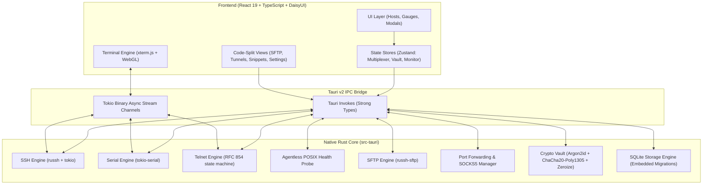

# Haze SSH

<p align="center">
  <strong>Fast, Privacy-First, Open-Source SSH Client, Terminal Multiplexer & Hardware Hub</strong>
</p>

<p align="center">
  
  
  
  
  
  
  
  
</p>

---

## 🌟 Overview

**Haze SSH** is a high-performance, lightweight, local-first desktop SSH client, terminal multiplexer, and hardware console built with **Tauri v2**, **Rust**, and **React 19**.

Unlike proprietary tools such as Termius, Haze SSH is **100% free, open-source, and zero-cloud**. Your private keys, server configurations, and session credentials never leave your local machine.

---

## 🚀 Key Feature Matrix

| Capability | Highlights |
| :--- | :--- |
| **Terminal Multiplexer** | WebGL/Canvas accelerated `xterm.js`, binary-tree split panes (vertical & horizontal), multi-tab workspaces, and DaisyUI ANSI palette synchronization. |
| **Multi-Protocol Hub** | Unified Quick Connect for **SSH** (`ssh://`), **Hardware Serial UART** (`serial://`), and **Telnet** (`telnet://`). |
| **Agentless Server Monitor** | Non-intrusive POSIX background probes returning real-time mini CPU cores, RAM, Load average, Disk utilization, and Uptime gauges without installing any server daemon. |
| **Hardware Serial Console** | Direct serial communication for routers, microcontrollers, and embedded devices (`/dev/tty.*`, `COM*`) with 8N1 controls, custom baud rates, and flow control. |
| **Telnet Client** | Full-duplex RFC 854 IAC state machine with Terminal-Type (RFC 1091) subnegotiation and NAWS window sizing (RFC 1073). |
| **SFTP & Remote Editor** | Dual-pane local-to-remote file explorer, drag & drop uploads, visual permission editor (`chmod`), and in-app remote configuration editor (`Cmd+S`). |
| **Port Forwarding & Tunnels** | Pure-Rust async Local (`-L`), Remote (`-R`), and Dynamic SOCKS5 (`-D`) proxy routing with live byte counters and OpenSSH command generation. |
| **Snippets & Batch Runner** | Parameterized scripts (`{{host.hostname}}`, `{{prompt:Name}}`), Run-on-Connect startup hooks, and multi-host concurrent execution. |
| **Encrypted Backup & Importers** | Portable encrypted `.haze` backups (Argon2id + ChaCha20-Poly1305), read-only OpenSSH (`~/.ssh/config`) importer, and Termius JSON / PuTTY `.reg` importers. |
| **Security & Privacy** | Local-first SQLite database, field-level authenticated AEAD encryption, optional Master Password, and zeroize memory wiping. |

---

## 🏗 Architecture



---

## ⌨️ Default Keyboard Shortcuts

| Shortcut (macOS) | Shortcut (Win / Linux) | Action |
| :--- | :--- | :--- |
| <kbd>⌘ K</kbd> | <kbd>Ctrl + K</kbd> | Open Command Palette |
| <kbd>⌘ T</kbd> | <kbd>Ctrl + T</kbd> | Open New Local Terminal Tab |
| <kbd>⌘ W</kbd> | <kbd>Ctrl + W</kbd> | Close Current Pane / Tab |
| <kbd>⌘ S</kbd> | <kbd>Ctrl + S</kbd> | Save Remote File in In-App Editor |

---

## 🛠 Getting Started

### Prerequisites

1. **Rust & Cargo** (v1.80+):
   ```bash
   curl --proto '=https' --tlsv1.2 -sSf https://sh.rustup.rs | sh
   ```
2. **Node.js** (v20 or higher) and `npm`
3. Platform-specific dependencies (see [Tauri Prerequisites](https://v2.tauri.app/start/prerequisites/)).

### Running Development Build

```bash
# 1. Clone the repository
git clone https://github.com/haze-ssh/haze-ssh.git
cd haze-ssh

# 2. Install frontend dependencies
npm install

# 3. Start Tauri development app
npm run tauri dev
```

### Building Production Release

```bash
# Package the optimized desktop executable for your operating system
npm run tauri build
```

Compiled desktop bundles will be generated in `src-tauri/target/release/bundle/`:
- **macOS**: `.dmg`, `.app` (Universal Apple Silicon & Intel)
- **Windows**: `.msi`, `.exe` (NSIS Installer)
- **Linux**: `.AppImage`, `.deb`

---

## 🧪 Verification & Automated Tests

Haze SSH includes end-to-end automated unit tests and strict compiler verification:

```bash
# Run Rust unit tests (Crypto, Telnet, Monitor, SSH Config & Importers)
cd src-tauri && cargo test

# Run Rust linter with zero warnings
cd src-tauri && cargo clippy -- -D warnings

# Run TypeScript check & optimized bundle compilation
npm run build
```

---

## 📄 License

This project is licensed under the [MIT License](LICENSE).
See [CONTRIBUTING.md](CONTRIBUTING.md) for contribution guidelines and [SECURITY.md](SECURITY.md) for our security policy.
