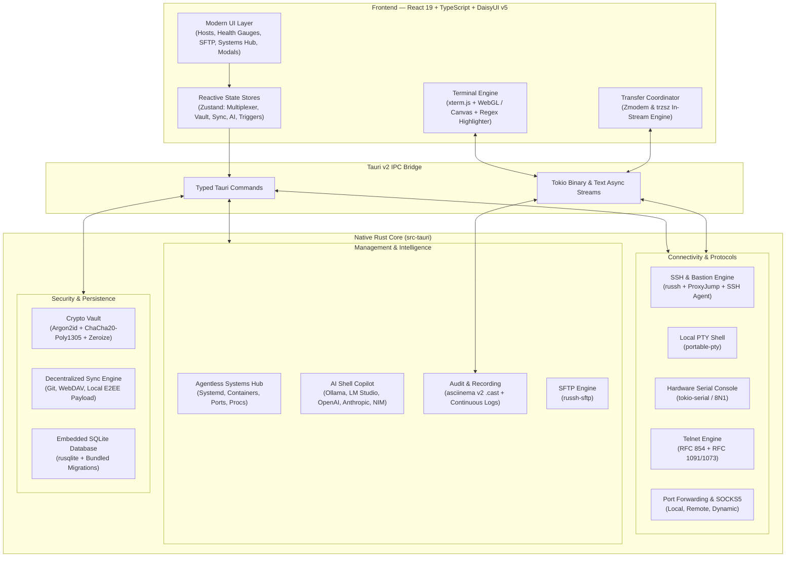

<p align="center">
  
</p>

<p align="center">
  <strong>Fast, Privacy-First, Open-Source Terminal Multiplexer, SSH Client & Hardware Hub</strong>
</p>

<p align="center">
  <a href="LICENSE"></a>
  <a href="#security--privacy-first-architecture"></a>
  <a href="CONTRIBUTING.md"></a>
</p>

<p align="center">
  <a href="#overview">Overview</a> •
  <a href="#key-capabilities">Key Capabilities</a> •
  <a href="#installation">Installation</a> •
  <a href="#architecture">Architecture</a> •
  <a href="#security--privacy-first-architecture">Security & Privacy</a> •
  <a href="#desktop-keyboard-shortcuts">Shortcuts</a> •
  <a href="PRIVACY.md">Privacy Policy</a> •
  <a href="#code-signing-policy">Code Signing Policy</a>
</p>

---

## Overview

**Haze SSH** is a high-performance, lightweight, local-first desktop SSH client, terminal multiplexer, hardware console, and agentless remote systems hub built with **Tauri v2**, **Rust**, and **React 19**.

Unlike cloud-dependent proprietary tools, Haze SSH is **100% free, open-source, and zero-telemetry**. All server credentials, private keys, session records, and connection profiles remain strictly on your local machine, protected by hardware-accelerated authenticated encryption (AEAD).

> [!NOTE]
> **Zero Cloud Subscriptions. Zero Analytics. Complete Privacy.**
> From local PTY terminal tabs to multi-hop ProxyJump tunnels, in-stream ZMODEM/trzsz file transfers, an agentless remote systems hub, and an opt-in privacy-first AI shell copilot (powered by local Ollama or hosted BYOK models), Haze SSH delivers an uncompromising workstation for systems engineers, DevOps teams, and homelab builders.

---

## Key Capabilities

### Modern Terminal Multiplexer & Local Shell
- **Hardware-Accelerated Rendering**: Smooth WebGL- and Canvas-accelerated terminal emulation powered by `xterm.js` with high-density scrollback buffer optimizations.
- **Native Local PTY Shell**: Launch native local shell sessions (`zsh`, `bash`, `PowerShell`, `cmd.exe`) directly in workspace tabs alongside remote SSH sessions via `portable-pty`.
- **Binary-Tree Multiplexing**: Infinitely split any tab horizontally (`Cmd/Ctrl + \`) or vertically (`Cmd/Ctrl + Shift + \`), resize panes seamlessly, and synchronize keystrokes across multiple active targets simultaneously.
- **Real-Time Keyword & Regex Highlighting**: Flag critical log errors, warnings, IP addresses, or custom patterns on the fly with configurable badges, outlines, and underlines.
- **Theme Engine & ANSI Palette Sync**: 10+ built-in designer palettes (Dracula, Nord, Tokyo Night, Catppuccin, One Dark, Solarized, Monokai, and more) synchronized with DaisyUI themes.

### Agentless Remote Systems Hub (Server Toolbox)
- **Zero Server Footprint**: Perform deep remote host inspections using non-intrusive standard POSIX probes over existing SSH channels — **no daemon, agent, or background service required on the server**.
- **Container Lifecycle Management**: Autodetects Docker and Podman, inspects running/stopped containers, exposes port bindings, streams logs, and provides one-click lifecycle controls (start, stop, restart).
- **Systemd Service Hub**: Query systemd unit states (active, inactive, failed), inspect journalctl output, restart or reload services, and execute safeguarded daemon kills with destructive action confirmations.
- **Listening Ports & Socket Attribution**: Map active TCP/UDP ports, public vs. localhost loopback bindings, and process attribution with PIDs.
- **Processes & Storage Mounts**: Monitor top CPU/memory consuming processes and live filesystem mount usage.
- **Real-Time Health Gauges**: Visual mini-gauges for CPU cores, RAM consumption, load average, disk utilization, and uptime directly in host cards and pane headers.

### Privacy-First AI Shell Copilot
- **Local & Cloud Inference Support**: Zero data leakage. Connect to local LLMs via **Ollama** or **LM Studio** where no bytes ever leave your machine, or bring your own API keys for **OpenAI**, **Anthropic**, **OpenRouter**, **Nvidia NIM**, **DeepSeek**, or custom OpenAI-compatible endpoints.
- **Inline Shell Generation (`Cmd/Ctrl + I`)**: Translate natural language instructions into precise shell commands directly inside active terminal sessions with one-click insertion.
- **Terminal Error Diagnostics**: Encountered an obscure exit code or stack trace? Let the copilot analyze the preceding terminal context and provide a structured explanation with suggested remediation.
- **Destructive Command Safety Guard**: Scans AI-generated commands against dangerous shell patterns (such as root recursive deletion, block device writes, and fork bombs) before execution.

### In-Terminal File Transfers & SFTP File Manager
- **Seamless In-Stream Transfers (ZMODEM & trzsz)**: Intercepts `rz`, `sz`, `trz`, and `tsz` stream sequences before they reach the terminal canvas, eliminating escape sequence bleeding and session freezing. Transfers open native OS file dialogs and display a floating in-pane HUD tracking progress, transfer rates, and cancellation.
- **Dual-Pane Local & Remote SFTP**: Side-by-side directory browser with parent navigation, directory bookmarking, batch selection, keyboard deletion, and drag-and-drop transfers.
- **In-App Syntax-Highlighted Code Editor**: Edit remote configuration files or inspect local scripts directly inside Haze SSH using CodeMirror syntax highlighting with instant save (`Cmd/Ctrl + S`).
- **Visual Permissions Editor**: Inspect and update file permissions with a visual octal/symbolic `chmod` modal.

### Connectivity, Bastion Tunneling & Multi-Protocol Hub
- **Unified Quick Connect**: Instant connection management for **SSH** (`ssh://`), **Hardware Serial UART** (`serial://`), and **Telnet** (`telnet://`).
- **Multi-Hop Bastion ProxyJump**: Transparent two-hop SSH and SFTP proxying through jump hosts and bastion servers via direct TCP/IP channels.
- **System SSH Agent Support**: Integrates with `SSH_AUTH_SOCK` to leverage hardware security keys (e.g., YubiKey) and system-managed private keys without re-entering passphrases.
- **Hardware Serial Console**: Direct serial communication for microcontrollers, routers, and embedded devices (`/dev/tty.*`, `COM*`) with 8N1 controls, baud rate selection, and hardware flow control.
- **RFC-Compliant Telnet Engine**: Full-duplex RFC 854 IAC state machine with Terminal-Type (RFC 1091) subnegotiation and NAWS window sizing (RFC 1073).
- **Pure-Rust Port Forwarding**: Pure-Rust asynchronous Local (`-L`), Remote (`-R`), and Dynamic SOCKS5 (`-D`) proxy routing with live traffic counters and OpenSSH command generation.

### Decentralized Cloudless E2EE Sync
- **No Proprietary Cloud Vendor Lock-In**: Sync connection profiles, identities, snippets, and settings seamlessly across multiple devices using **Git** (GitHub, GitLab, Gitea, custom Git servers), **WebDAV** (Nextcloud, ownCloud, NAS), or **Local / Shared Folders** (Syncthing, iCloud Drive, Dropbox).
- **End-to-End AEAD Encryption**: Sync payloads are exported as encrypted `.haze` packages protected by **Argon2id** and **ChaCha20-Poly1305**. Keys and secrets never exist unencrypted in transit or on sync remotes.
- **Differential Conflict Resolution**: Interactive side-by-side merge dialog to inspect remote vs. local record changes and resolve discrepancies with zero data loss.

### Audit Trails, Recordings & Automation
- **Asciinema v2 Session Recording**: Record interactive sessions into standardized newline-delimited `.cast` recordings with one-click pane header controls and native save dialogs.
- **Continuous Session Audit Logging**: Debounced, streaming audit logger writing to `~/.haze/logs` with microsecond timestamps and optional ANSI escape stripping for tamper-evident compliance.
- **Automated Triggers & Expect Rules**: Sliding-buffer regex monitor that intercepts terminal patterns across TCP packet boundaries to auto-respond to stdin prompts, fire desktop notifications, or trigger Web Audio alerts.
- **Snippets & Batch Runner**: Dynamic script runner supporting parameter placeholders (`{{host.hostname}}`, `{{prompt:Variable}}`), Run-on-Connect startup hooks, and concurrent multi-host batch execution.

### Cryptographic Vault & Universal Migration
- **Zero-Knowledge Architecture**: Credentials, private keys, and passphrases are stored in an embedded SQLite database encrypted with authenticated AEAD (`ChaCha20-Poly1305`) derived via `Argon2id`.
- **Master Passphrase Protection & Zeroize**: Sensitive credentials in memory are wrapped in `zeroize` buffers to prevent memory dumping, with global lock/unlock controls and automated idle lockout.
- **Universal Importers**:
  - **PuTTY**: Auto-detects installed PuTTY sessions and parses `.reg` export files.
  - **OpenSSH**: Imports hosts, aliases, identities, and proxy directives directly from `~/.ssh/config`.
  - **Termius**: One-click import for unencrypted Termius JSON exports.
- **Encrypted Portability**: Export and restore password-protected `.haze` vault archives using native file pickers.

---

## Installation

Official release packages for macOS, Windows, and Linux are available on the [Releases page](https://github.com/ahmetaltun/HazeSSH/releases):

- **macOS**: Universal Disk Image (`.dmg`) supporting Apple Silicon (M-Series) and Intel processors.
- **Windows**: Modern executable setup (`.exe` via NSIS) and Windows Installer (`.msi`).
- **Linux**: Portable `.AppImage`, Debian package (`.deb`), and Red Hat package (`.rpm`).

Automated checksums (`SHA256SUMS.txt`) and GPG detached signatures are generated with each release.

### Building from Source

#### Prerequisites

1. **Rust Toolchain** (v1.85+ recommended):
   ```bash
   curl --proto '=https' --tlsv1.2 -sSf https://sh.rustup.rs | sh
   ```
2. **Node.js** (v20+ LTS) and `npm`.
3. Platform-specific dependencies (see [Tauri v2 Prerequisites](https://v2.tauri.app/start/prerequisites/)).

#### Development Workflow

```bash
# 1. Clone the repository
git clone https://github.com/ahmetaltun/HazeSSH.git
cd HazeSSH

# 2. Install frontend dependencies
npm install

# 3. Launch Tauri development desktop application
npm run tauri dev
```

#### Packaging Production Binaries

```bash
# Build optimized desktop package for your current operating system
npm run tauri build
```

Compiled desktop packages are output to `src-tauri/target/release/bundle/`.

---

## Architecture



---

## Security & Privacy-First Architecture

Haze SSH is engineered from the ground up on a **zero-trust, zero-cloud foundation**. All server credentials, private keys, and session records remain on your local machine:

| Security Domain | Implementation Details |
| :--- | :--- |
| **Data Residency** | 100% local-first. Credentials, host inventories, and session logs never touch external servers or telemetry endpoints. |
| **At-Rest Encryption** | Field-level authenticated AEAD encryption using **ChaCha20-Poly1305** with cryptographic keys derived via **Argon2id** (memory-hard password hashing). |
| **In-Memory Safety** | Critical passphrase and key memory buffers implement Rust's `zeroize` trait, wiping sensitive bytes from memory when dropped or upon vault auto-lock. |
| **Master Passphrase** | Optional global master passphrase with configurable idle auto-lock timers and on-demand unlocking for protected operations. |
| **Telemetry & Analytics** | **Zero telemetry.** No tracking pixels, Google Analytics, PostHog, Sentry, or third-party crash reporters are included in the application. |

### Network Connection Disclosures

In accordance with our [Privacy Policy](PRIVACY.md) and code signing standards, network activity is strictly categorized into user-initiated and opt-in automated connections:

#### 1. User-Initiated Network Connections
- **SSH & Bastion Sessions**: Direct TCP connections (port 22 or custom) to user-configured destination hosts and multi-hop ProxyJump jump hosts.
- **SFTP & In-Terminal File Transfers**: File operations and in-stream ZMODEM (`rz`/`sz`) or `trzsz` transfers initiated directly over active SSH channels.
- **Hardware Serial UART & Telnet**: Local serial communication (`/dev/tty.*`, `COM*`) and RFC 854 Telnet connections to user-specified targets.
- **Port Forwarding & Tunnels**: Pure-Rust asynchronous Local (`-L`), Remote (`-R`), and Dynamic SOCKS5 (`-D`) proxy tunnels.
- **Agentless Systems Hub (Toolbox)**: Lightweight POSIX probes dispatched over SSH to inspect containers, systemd services, listening sockets, and processes. No server agent or daemon is installed.
- **AI Shell Copilot (On-Demand)**: Dispatched only upon user keystroke (`Cmd/Ctrl + I`) or when requesting error diagnosis. Local inference (`http://localhost:11434` or `http://localhost:1234`) operates with zero external network egress. Hosted BYOK providers (OpenAI, Anthropic, OpenRouter, Nvidia NIM, DeepSeek) communicate directly with the chosen provider using the user's provided API key.
- **Decentralized Vault Sync (Manual)**: Dispatched when clicking "Sync Now" (`Cmd/Ctrl + Alt + S`). Sends an encrypted `.haze` package to the user's configured Git or WebDAV server.
- **Software Update Check (Manual)**: Dispatched when clicking "Check for Updates" in Settings -> About & Updates. Connects to GitHub Releases (`latest.json`) to verify version manifests.

#### 2. Automatic Network Connections
- **Default State**: Out-of-the-box, Haze SSH makes **zero automatic or background network connections**.
- **Automated Vault Sync (Opt-In Only)**: Disabled by default (`autoSyncEnabled: false`). When explicitly enabled in Settings, polls the user's configured Git or WebDAV remote at a user-defined interval (default: 30 minutes) or on app startup with an Argon2id + ChaCha20-Poly1305 encrypted payload.
- **Automated Server Health Polling (Opt-In Only)**: Disabled by default. When toggled in the Hosts view ("Live 30s"), executes non-intrusive POSIX health probes over SSH every 30 seconds against visible configured hosts.
- **Silent Background Updates**: Haze SSH does not silently download or apply updates in the background.

For comprehensive details on data residency, encryption algorithms, and network disclosures, review the complete [PRIVACY.md](PRIVACY.md).

---

## Desktop Keyboard Shortcuts

| Shortcut (macOS) | Shortcut (Win / Linux) | Action |
| :--- | :--- | :--- |
| <kbd>⌘ K</kbd> | <kbd>Ctrl + K</kbd> | Open Command Palette |
| <kbd>⌘ ⇧ P</kbd> | <kbd>Ctrl + Shift + P</kbd> | Developer Command Palette |
| <kbd>⌘ ,</kbd> | <kbd>Ctrl + ,</kbd> | Open Preferences / Settings |
| <kbd>⌘ B</kbd> | <kbd>Ctrl + B</kbd> | Toggle Sidebar Collapse |
| <kbd>⌘ 1–6</kbd> | <kbd>Ctrl + 1–6</kbd> | Quick Switch to Views (Hosts, SFTP, Tunnels, Snippets, History, Settings) |
| <kbd>⌘ /</kbd> | <kbd>Ctrl + /</kbd> | Open Keyboard Shortcuts Cheat Sheet |
| <kbd>⌘ ⌥ S</kbd> | <kbd>Ctrl + Alt + S</kbd> | Trigger Decentralized Vault Sync Now |
| <kbd>⌘ I</kbd> | <kbd>Ctrl + I</kbd> | Launch AI Shell Copilot Prompt in Active Terminal |
| <kbd>⌘ T</kbd> | <kbd>Ctrl + T</kbd> | Open New Local Terminal Tab |
| <kbd>⌘ W</kbd> | <kbd>Ctrl + W</kbd> | Close Current Active Pane |
| <kbd>⌘ ⇧ W</kbd> | <kbd>Ctrl + Shift + W</kbd> | Close Entire Terminal Tab |
| <kbd>⌘ \</kbd> | <kbd>Ctrl + \</kbd> | Split Active Pane Horizontally |
| <kbd>⌘ ⇧ \</kbd> | <kbd>Ctrl + Shift + \</kbd> | Split Active Pane Vertically |
| <kbd>⌘ ⌥ B</kbd> | <kbd>Ctrl + Alt + B</kbd> | Toggle Broadcast Keystrokes across Open Panes |
| <kbd>⌘ F</kbd> | <kbd>Ctrl + F</kbd> | Search in Buffer / Active View |
| <kbd>⌘ S</kbd> | <kbd>Ctrl + S</kbd> | Save Remote File in In-App Editor |
| <kbd>⌘ A</kbd> | <kbd>Ctrl + A</kbd> | Select All Files in SFTP Pane |
| <kbd>Tab</kbd> | <kbd>Tab</kbd> | Switch Active Focus between SFTP Panes |

---

## Verification & Automated Tests

Haze SSH enforces strict compiler verification, clippy linting, and automated unit test suites:

```bash
# Run Rust unit tests (Crypto vault, Telnet IAC, SFTP, Importers, POSIX Monitor)
cd src-tauri && cargo test

# Run Rust linter with zero warnings tolerated
cd src-tauri && cargo clippy -- -D warnings

# Run TypeScript typechecks & optimized frontend compilation
npm run build
```

---

## License

This project is licensed under the [MIT License](LICENSE).
See [CONTRIBUTING.md](CONTRIBUTING.md) for contribution guidelines and [SECURITY.md](SECURITY.md) for our security reporting policy.

---

## Code signing policy

Official Windows releases of HazeSSH are intended to be
digitally signed through SignPath Foundation.

Free code signing provided by SignPath.io, certificate
by SignPath Foundation.

### Project repository

https://github.com/ahmetaltun/HazeSSH

### Team roles

- Authors / Committers: Ahmet Altun (@ahmetaltun)
- Reviewers: Ahmet Altun (@ahmetaltun)
- Signing Approvers: Ahmet Altun (@ahmetaltun)

External contributions must be reviewed before merging.
Signing requests must be manually approved by an
authorized project maintainer.

### Build and release security

- Official releases originate from this public repository.
- Release artifacts are built through approved CI workflows.
- Signing is restricted to verified source-controlled builds.
- All maintainers with repository or signing access must
  use multi-factor authentication.
- Each production signing request requires manual approval.
- Signing credentials are not stored in source control.

### Privacy

HazeSSH is designed as a local-first SSH client.

Server credentials, private keys, and connection
configuration are intended to remain on the user's device.

Network communication is initiated for functionality
requested or configured by the user, including SSH, SFTP,
Telnet, port forwarding, and server monitoring.

Any additional network services, connection behaviors, and
telemetry disclosures are documented in the project's
[Privacy Policy](PRIVACY.md).

### Signing status

Code signing is planned. Until SignPath Foundation
approval and integration are complete, Windows releases
may be unsigned.
