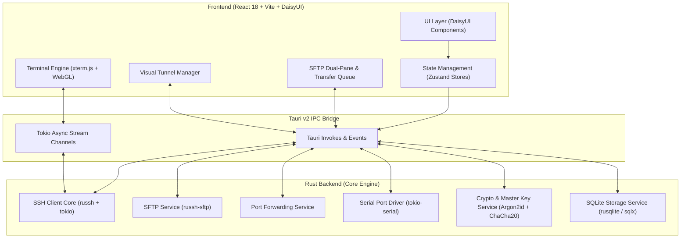

# Haze SSH — Architectural Blueprint & Roadmap

## 1. Vision & Core Philosophy

**Haze SSH** is a modern, high-performance, privacy-first, zero-cloud SSH client and terminal environment built with **Rust + Tauri v2**, **React**, **Tailwind CSS**, **DaisyUI**, and **SQLite**.

### Key Differences vs. Termius
| Feature / Dimension | Termius | Haze SSH |
| :--- | :--- | :--- |
| **License & Pricing** | Proprietary, subscription-based ($10–$30/mo) | **100% Free & Open Source (GPL-3.0 / MIT/Apache-2.0)** |
| **Data Privacy** | Cloud-synced by default; proprietary server storage | **100% Local-First; zero tracking, zero cloud telemetry** |
| **Resource Usage** | Electron (~400MB–800MB RAM, high idle CPU) | **Tauri + Rust (~40MB–70MB RAM, near-zero idle CPU)** |
| **Pro Features** | Tunnels, SFTP, Snippets paywalled | **All Pro & Advanced features included for free** |
| **Extensibility** | Closed ecosystem | **Open ecosystem, scriptable, community themes/plugins** |
| **Hardware / IoT Support** | Limited / Basic | **Native Serial/UART + Telnet + SSH Bastions** |

---

## 2. Comprehensive Feature Matrix

### A. Host & Connection Management
- **Hierarchical Organization**: Nested folders, tags, custom color markers, and host avatars.
- **Identity & Credential Store**: Decoupled identities (Username + Password / SSH Key / Certificate) reusable across hosts.
- **Key Types**: Ed25519, RSA (2048/4096), ECDSA, PKCS#8, PEM, OpenSSH formats.
- **SSH Agent Integration**: Forwarding to local agent (OpenSSH Agent, Pageant, 1Password CLI, GPG Agent).
- **Proxy & Bastion (Jump Hosts)**: Chained ProxyJump (`ssh -J jump1,jump2 target`) and SOCKS5/HTTP proxy support.
- **Connection Keepalive**: Configurable `ServerAliveInterval` and automatic reconnection logic on network drop.

### B. High-Performance Terminal Emulator
- **Engine**: `xterm.js` powered by WebGL/Canvas acceleration for 60+ FPS rendering under heavy terminal output.
- **Layout Multiplexing**:
  - Multi-tab management with tab grouping and color badges.
  - Split Panes (vertical & horizontal) with draggable dividers.
- **Broadcast Input (Multi-Exec)**: Type once to stream keystrokes across multiple open hosts simultaneously.
- **Themes & Aesthetics**: DaisyUI theme switching (20+ built-in themes like Dracula, Synthwave, Nord, Cyberpunk) + custom ANSI palette editor, ligature support, and Nerd Fonts integration.
- **Session Recording & Transcripts**: One-click logging to text or asciinema format for auditing and sharing.

### C. SFTP & Remote File Manager
- **Dual-Pane Interface**: Local-to-Remote and Remote-to-Remote side-by-side navigators.
- **Drag & Drop**: Seamless file and directory transfers with real-time transfer progress, speed graph, and queue manager.
- **Remote In-App Editor**: Lightweight Monaco or CodeMirror editor to edit remote configuration files (`/etc/nginx/...`) with direct upload on save.
- **Permission & Attribute Control**: Visual `chmod` / `chown` modal, symlink navigation, hidden file toggles, bookmarks.

### D. Port Forwarding & Tunnels Manager
- **Supported Modes**:
  - Local Forwarding (`-L local_port:remote_host:remote_port`)
  - Remote / Reverse Forwarding (`-R remote_port:local_host:local_port`)
  - Dynamic Forwarding / SOCKS5 Proxy (`-D port`)
- **Visual Tunnel Topology**: Graph view showing connection routes, active tunnel status, and bandwidth counters.
- **Persistent Tunnels**: Background auto-restart option for active tunnels.

### E. Snippets & Command Automation
- **Snippet Library**: Categorized script snippets with tag filtering.
- **Dynamic Variable Templating**: Variables like `{{host.ip}}`, `{{user}}`, `{{env_var}}`, or prompt-on-run `{{input:Port}}`.
- **Run on Connect**: Automatically execute bootstrap scripts or environment setups upon terminal session initialization.
- **Batch Command Runner**: Execute an ad-hoc snippet against a selected host group with formatted stdout/stderr summaries.

### F. Security & Privacy-First Architecture
- **Zero-Cloud / Offline Guaranteed**: No remote servers, no user accounts required.
- **Optional Master Password & Vault Locking**:
  - Master password protection is **optional**: users can choose to protect their local credentials with an Argon2id-derived master passphrase, leverage OS Keychain / biometric unlock, or use seamless local device-key encryption.
  - Sensitive secrets (private keys, passwords, passphrases) are encrypted at rest using ChaCha20-Poly1305 / AES-256-GCM.
- **Secure OpenSSH Integration**:
  - Secure **read-only selective import**: parse `~/.ssh/config` and `known_hosts` into Haze SSH with explicit preview, diff comparison, and selective import (avoiding accidental writes or security leaks).
- **Host Key Verification**: Interactive fingerprint dialog (SHA256 visual host fingerprint) with strict known_hosts checks to protect against Man-In-The-Middle (MITM) attacks.

### G. Backup, Import & Export
- **Full Backup**: Encrypted `.haze` backup bundle (AES-GCM encrypted with user passphrase) containing all hosts, identities, snippets, and settings.
- **Seamless Importers**:
  - Import from `~/.ssh/config` and `~/.ssh/known_hosts`.
  - Import from Termius (JSON export format).
  - Import from PuTTY sessions / `.reg`.

### H. Beyond-Termius Features
- **Serial / UART Console**: Direct serial connection for routers, switches, Arduinos, and embedded devices (`/dev/tty.*`, `COM*`).
- **Telnet Support**: Legacy device support.
- **Agentless Server Health Monitor**: Lightweight, non-intrusive background queries (`uptime`, `free -m`, `top`, `df -h`) over SSH to show mini CPU/RAM/Disk gauges on host cards without needing any server daemon installed.
- **Multi-Vault Isolation**: Separate Personal, Work, and Client environments with distinct encryption keys.

---

## 3. High-Level Architecture

---

## 4. Technical Opinions & Recommendations

> [!NOTE]
> **1. SSH Engine: Pure Rust (`russh`) vs. C wrapper (`ssh2` / `libssh2`)**
> - **Recommendation**: Use `russh` (Tokio-native, pure Rust).
> - **Rationale**: `ssh2` links against C `libssh2` and OpenSSL, which creates painful cross-compilation issues for macOS (Universal Binary), Linux, and Windows. `russh` is 100% async Tokio native, runs purely in safe Rust, supports modern cryptography (Curve25519, ChaCha20-Poly1305, Ed25519), and integrates directly into Tauri v2's Tokio runtime without blocking worker threads.

> [!TIP]
> **2. Database & Encryption Architecture**
> - **Recommendation**: Rust-managed SQLite with field-level authenticated encryption (ChaCha20-Poly1305 or AES-256-GCM) or SQLCipher.
> - **Rationale**: Storing non-sensitive UI state (window bounds, theme preference, last viewed host) in plaintext enables fast app cold-boots, while all sensitive fields (private keys, passwords, passphrases, tokens) are strictly encrypted at rest with keys derived via Argon2id from the Master Password or OS Keychain.

> [!IMPORTANT]
> **3. Terminal IPC Streaming**
> - **Recommendation**: Use Tauri v2's native `Channel` / binary streaming events rather than standard JSON strings.
> - **Rationale**: High-throughput terminal output (e.g., `cat large_file.log` or `htop`) can easily saturate standard JSON serialization. Tauri v2 Channels allow streaming raw UTF-8 byte buffers directly from Rust Tokio tasks to `xterm.js` with microsecond latency.

---

## 5. Phased Implementation Roadmap

```mermaid
flowchart LR
    P1["Phase 1: Setup & Scaffolding"] --> P2["Phase 2: DB & Crypto Vault"]
    P2 --> P3["Phase 3: Host & Identity CRUD"]
    P3 --> P4["Phase 4: SSH & Terminal Core"]
    P4 --> P5["Phase 5: SFTP & Remote Editor"]
    P5 --> P6["Phase 6: Port Forwarding"]
    P6 --> P7["Phase 7: Snippets & Scripts"]
    P7 --> P8["Phase 8: Backup & Importers"]
    P8 --> P9["Phase 9: Pro Extras (Monitor, Serial)"]
    P9 --> P10["Phase 10: Release & Polish"]
```

### Phase 1: Project Scaffolding & Design System [Completed]
- [x] Initialize Tauri v2 + React 19 (TypeScript) + Vite project.
- [x] Configure Tailwind CSS + DaisyUI with full multi-theme switching (13+ themes).
- [x] Establish clean directory structure with `@/*` root alias.
- [x] Install Zustand and Zod for modular state and schema validation.
- [x] Implement responsive app shell (collapsible sidebar, topbar with quick connect, status bar).
- [x] Implement multi-tab & recursive binary-tree split pane multiplexer foundation.

### Phase 2: Database Engine & Cryptography Vault [Completed]
- [x] Setup SQLite database with embedded schema migrations in Rust (`rusqlite` bundled).
- [x] Design database schema: `hosts`, `groups`, `identities`, `snippets`, `tunnels`, `vault_settings`.
- [x] Implement Crypto Module: Argon2id key derivation, ChaCha20-Poly1305 authenticated encryption/decryption.
- [x] Add zeroize memory wiping for private encryption keys.
- [x] Implement complete Tauri IPC bridge commands for Vault, Hosts, Groups, Identities, Snippets, and Tunnels.
- [x] Connect frontend Zustand stores (`useVaultStore`, `useHostStore`) and Zod runtime validation schemas.
- [x] Build interactive `VaultModal` for Master Password setup, unlocking, and locking.

### Phase 3: Host & Identity Management (UI & Logic) [Completed]
- [x] Implement Host Management UI: Grid cards and Table list views with search and tag filters.
- [x] Host Groups: Collapsible folder navigation with host counts and color markers.
- [x] Identity Manager: Decoupled credentials (Passwords, OpenSSH Private Keys with passphrases).
- [x] In-App Key Generator: Pure Rust keypair generation (Ed25519 & RSA) with 1-click public key copy and fingerprint.
- [x] Host Configuration modal: Address, port, username, group, identity, Bastion/Jump Host (ProxyJump) selector, tags, and color.

### Phase 4: Core SSH & Terminal Emulator [Completed]
- [x] Implement pure-Rust `russh` async connection manager on Tokio with keepalives.
- [x] Support password, OpenSSH private keys (with passphrases), and automated secret vault decryption.
- [x] High-throughput binary streaming using Tauri v2 Channels (`SshEvent::Data`, `StatusChange`, `Exit`, `Error`).
- [x] Dynamic PTY resize synchronization (`ResizeObserver` -> `FitAddon` -> `ssh_resize`).
- [x] Integrate `@xterm/xterm` with Fit, Search, and WebLinks add-ons in split panes.
- [x] Synchronize 24-bit ANSI terminal color palettes dynamically with active DaisyUI themes.

### Phase 5: SFTP & Remote File Management [Completed]
- [x] Implement SFTP backend via `russh-sftp` subsystem with authenticated session management.
- [x] Build dual-pane file explorer in React (`FileExplorerPane`) supporting local and remote filesystems.
- [x] File operations: Directory traversal, path breadcrumbs, new folder, delete, rename, and file permissions.
- [x] In-app remote file editor (`RemoteEditorModal`) with `Cmd+S` save back to remote server and unsaved changes warnings.
- [x] Transfer queue tray with live progress bars and completed transfers tracking.

### Phase 6: Port Forwarding & Tunnels [Completed]
- [x] Pure-Rust async port forwarding engine (`src-tauri/src/tunnels.rs`) supporting Local, Remote, and Dynamic (SOCKS5) modes.
- [x] Local Port Forwarding (`-L`): Local `TcpListener` with `russh::channel_open_direct_tcpip` and streaming proxy.
- [x] Remote Port Forwarding (`-R`): Remote server `tcpip_forward` with `server_channel_open_forwarded_tcpip` handler and local stream bridging.
- [x] Dynamic SOCKS5 Proxy (`-D`): Built-in RFC 1928 SOCKS5 protocol handshake and arbitrary destination routing over SSH.
- [x] Real-time atomic traffic telemetry: Live tracking of bytes received, bytes sent, and active client connections.
- [x] Thread-safe `TunnelManager` with cancellation tokens and instant stop controls.
- [x] Zustand tunnel store (`useTunnelStore.ts`) with live polling and layout counter synchronization.
- [x] Visual Tunnel Configuration modal (`TunnelModal.tsx`) with real-time routing preview and validation.
- [x] Full Tunnel Dashboard (`TunnelsView.tsx`) with status badges, bandwidth meters, search, type filters, and 1-click OpenSSH command generation.

### Phase 7: Snippets & Command Automation
- Implement Snippets database and management UI.
- Support dynamic variable interpolation (`{{var}}`) and interactive prompts before execution.
- Add Run-on-Connect hooks to host profiles.
- Build Multi-host batch snippet execution modal.

### Phase 8: Backup, Export & Importers
- Full backup export: Encrypted `.haze` archive creation.
- Full backup import: Decryption, schema verification, and restore.
- Importers: Parse `~/.ssh/config`, Termius JSON exports, and PuTTY configurations.

### Phase 9: Hardware (Serial), Telnet & Server Health Monitor
- Serial port integration via `tokio-serial` for hardware consoles.
- Telnet client integration for legacy systems.
- Agentless Server Health widget: execute non-intrusive resource checks and display CPU/RAM/Disk gauges.

### Phase 10: Performance Optimization, Auditing & GitHub Release
- Binary size optimization (LTO, strip, release profile tuning).
- End-to-end testing, error handling, and security review.
- GitHub Actions CI/CD for multi-platform builds (macOS dmg, Windows msi/exe, Linux AppImage/deb).
- Documentation, README, and Open Source release readiness.
